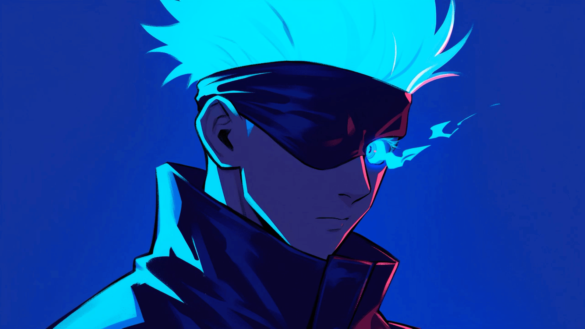

<div align="center">

<!-- Landscape Anime Banner (Gojo Satoru Cyberpunk Aesthetic) -->


<!-- Typing Animation -->
<a href="https://github.com/zansxdev">
  
</a>

<!-- Profile View Badges -->
<p align="center">
  
  
  
</p>

<!-- Cyberpunk Divider GIF -->


</div>

### 💫 About Me

```javascript
const izar = {
  name: "Izar Agustian",
  username: "zansxdev",
  role: "Full-Stack Developer • Video & Motion Designer",
  location: "Indonesia 🇮🇩",
  passions: [
    "Modern Web Applications",
    "Telegram & WhatsApp Bot Automations",
    "Cinematic Video Editing & Motion Graphics",
    "AI Tools & Workflow Integration"
  ],
  creativeArsenal: [
    "Premiere Pro", "After Effects", "Photoshop", "Illustrator",
    "CapCut", "Alight Motion", "Figma", "Blender", "Canva"
  ],
  techStack: ["JavaScript", "TypeScript", "Node.js", "Python", "React", "Linux"],
  currentFocus: "Architecting high-performance bots & creative digital experiences",
  motto: "Crafting code with logic, shaping visual art with passion."
};
```

- 🔭 **What I Do**: Building modern web applications, custom automated bots, and high-impact visual media.
- 🎬 **Creative Arsenal**: Passionate about motion graphics, visual effects (VFX), color grading, and video editing.
- ⚡ **Superpower**: Seamlessly connecting logic-driven engineering with stunning visual aesthetics.
- 📫 **Reach Out**: Let's connect at **[zansxart@gmail.com](mailto:zansxart@gmail.com)**.

<div align="center">
  
</div>

### 🎬 Creative & Video Editing Arsenal

<p align="center">
  
  
  
  
  
  
  
  
  
</p>

### 💻 Development & Programming Stack

<p align="center">
  <a href="https://skillicons.dev">
    
  </a>
</p>

<div align="center">
  
</div>

### 🐍 GitHub Contribution Snake

<div align="center">
  <picture>
    <source media="(prefers-color-scheme: dark)" srcset="https://raw.githubusercontent.com/zansxdev/zansxdev/output/github-contribution-grid-snake-dark.svg">
    <source media="(prefers-color-scheme: light)" srcset="https://raw.githubusercontent.com/zansxdev/zansxdev/output/github-contribution-grid-snake.svg">
    
  </picture>
</div>

<br/>

### 📊 GitHub Activity & Statistics

<div align="center">
  
  
</div>

<div align="center">
  
</div>

<div align="center">
  
</div>

### 🌐 Connect With Me

<p align="center">
  <a href="mailto:zansxart@gmail.com">
    
  </a>
  <a href="https://github.com/zansxdev">
    
  </a>
</p>
