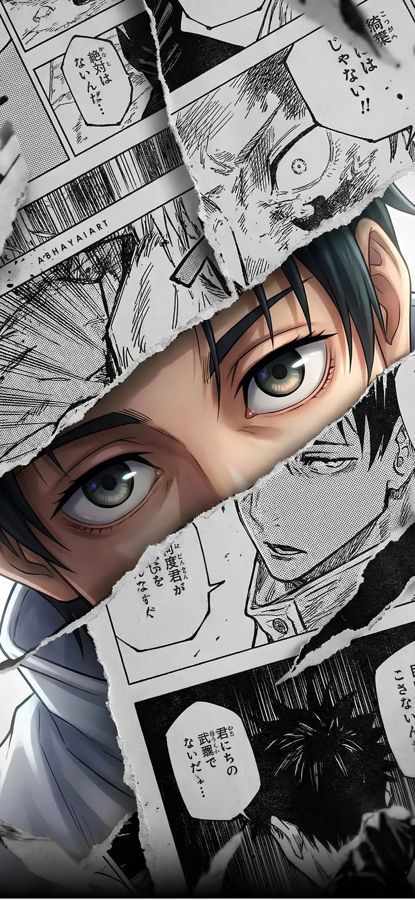

  

**Izar Agustian** (`zansxdev`)  
*Digital Creative Full-Stack Developer | Web & WhatsApp/Telegram Bots — With a Touch of AI.*

Based in Indonesia, specializing in building modern web applications, high-performance automated bot ecosystems, and cinematic digital multimedia.

- **Web Development**: Modern responsive web apps, REST APIs, database architecture, and backend systems
- **Bot Automation**: Production-ready WhatsApp & Telegram bot engines, webhook listeners, and background tasks
- **Artificial Intelligence**: Integrating smart LLM reasoning, conversational agents, and automated AI pipelines
- **Creative & Motion**: Professional video editing, motion design, visual effects (VFX), color grading, and UI/UX
- **Contact**: [zansxart@gmail.com](mailto:zansxart@gmail.com)

 

 

---

### Creative Arsenal

  

---

### Tech Stack

  

---

### Contribution Graph

  <picture>
    <source media="(prefers-color-scheme: dark)" srcset="https://raw.githubusercontent.com/zansxdev/zansxdev/output/github-contribution-grid-snake-dark.svg">
    <source media="(prefers-color-scheme: light)" srcset="https://raw.githubusercontent.com/zansxdev/zansxdev/output/github-contribution-grid-snake.svg">
    
  </picture>

---

### GitHub Statistics

  
  

 

  

---

### Connect

  
  

